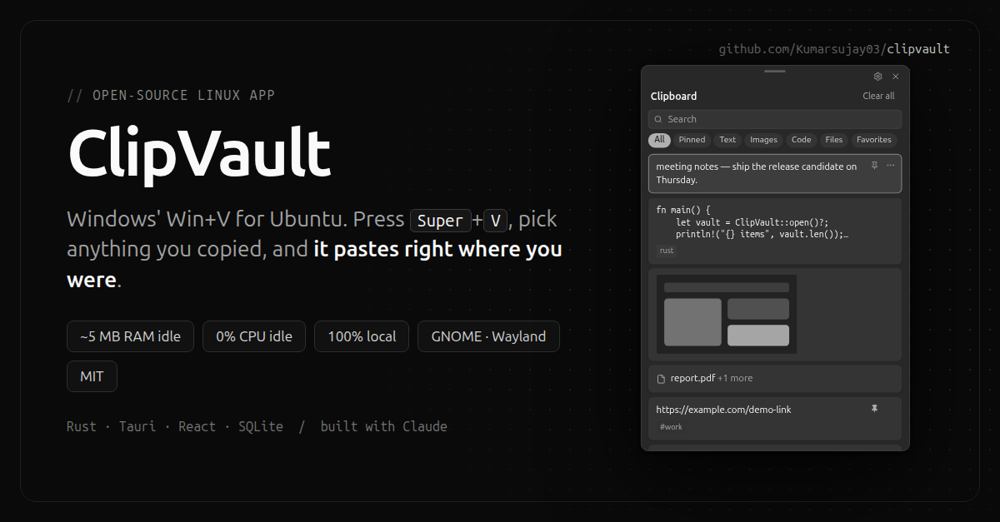

# ClipVault

<p align="center"></p>

Windows-style clipboard history for Ubuntu: press **Super+V**, pick an item, and it's pasted. It runs on GNOME 50 / Wayland (X11 too) and stays private: everything lives on your computer.

[](https://github.com/Kumarsujay03/clipvault/actions/workflows/ci.yml) [](LICENSE)

## Features

- **Super+V panel** like Windows: a small rounded popup with your recent copies. Click or press Enter to paste, Esc to close, and it closes when you click elsewhere.
- **Captures** text, code (with language detection), images and screenshots, copied files and rich text.
- **Pin** items you reuse (they're never cleaned up), mark favorites, and add **#tags**.
- **Instant search** across text, file names, tags and, optionally, text inside images (local OCR).
- **Tiny footprint.** When the panel is closed, only a ~5 MB background service runs, with 0% CPU while idle. The panel (~265 MB while open, mostly WebKit) loads in about 0.35 s when you open it and unloads after a configurable delay.
- **Starts at login**, and the top-bar icon can be hidden (Settings → General).
- **Private:** no network access (except when you check for updates), no telemetry, nothing logged. You get pause/resume, privacy mode, retention limits and a filter for likely passwords and keys.
- **Backup and restore** to `~/Documents/ClipVault Backups/`.
- Light and dark themes follow the system.

## Install

### Option 1: download the .deb (Ubuntu 24.04 or newer)

1. Download `ClipVault_0.2.1_amd64.deb` from the [latest release](https://github.com/Kumarsujay03/clipvault/releases/latest).
2. Install it and set it up for your user:

```bash
sudo apt install ./ClipVault_0.2.1_amd64.deb
clipvault --setup
clipvault --daemon &
```

3. **Log out and back in once.** That activates the GNOME extension, which opens the panel at your pointer and pastes for you. Then press **Super+V**.

`--setup` does three things for your user:

- turns on **start at login** for the small capture service
- makes **Super+V** open ClipVault (GNOME's own Super+V notification shortcut is moved aside; **Super+M** still opens notifications, and everything is restored on uninstall)
- installs the **GNOME extension**

There's also a portable **AppImage** on the release page:

```bash
chmod +x ClipVault_0.2.1_amd64.AppImage && ./ClipVault_0.2.1_amd64.AppImage --setup
```

> **Compatibility:** the prebuilt packages are built on Ubuntu 24.04 and run on Ubuntu 24.04 or newer. On other distributions, build from source (below). The GNOME extension supports GNOME Shell 45–50.

### Option 2: build from source

```bash
sudo apt install build-essential libwebkit2gtk-4.1-dev librsvg2-dev libayatana-appindicator3-dev libxdo-dev nodejs npm rustup wl-clipboard
rustup default stable
git clone https://github.com/Kumarsujay03/clipvault.git
cd clipvault
npm ci
npm run tauri build
./scripts/install.sh
```

`install.sh` installs the freshly built `.deb` (using sudo only for that) and runs the same setup.

Optional: install `tesseract-ocr` and turn on *Settings → Capture → Make text in images searchable*.

### Updating

- **From the app:** Super+V → ⚙ Settings → **Updates** → *Check for updates* → *Install update*. ClipVault downloads the new release, verifies its checksum, installs it (a `.deb` asks for your password) and restarts itself.
- **From the terminal:** `clipvault --update`
- **Automatically:** turn on *Check automatically once a day* in Settings → Updates (off by default). The panel shows a banner when a new version is out.
- Upgrading with `apt` or a newer `.deb` also works: the background service notices and restarts on the new version by itself.

What changed in each version: [CHANGELOG.md](CHANGELOG.md).

> Coming from **0.1.0**? It has no updater yet. Install 0.2.0 once (download the `.deb` above, or `git pull` and `./scripts/install.sh`), and every later version can be installed from the app.

### Hide the top-bar icon

Press Super+V, open **⚙ Settings → General**, and turn off **Show icon in the top bar**.

## Using it

| Key | Action |
|---|---|
| **Super+V** | open / close the panel |
| ↑ ↓ / PgUp PgDn | move |
| **Enter** / click | paste the item (or copy it, without the extension) |
| Shift+Enter, Ctrl+C | copy only |
| Space | preview (full text, image, files, tags) |
| Ctrl+P | pin / unpin |
| Del | delete |
| type anything | search; `#tag` finds tagged items |
| Esc | back, clear search, close |

The **…** menu on each card has Copy only, Preview, Pin, Favorite and Delete. The gear icon opens Settings.

## Uninstall

```bash
clipvault --remove-integration    # shortcut, extension, start at login
clipvault --quit
sudo apt remove clip-vault
```

From a source checkout, `./scripts/uninstall.sh` does the same; add `--purge` to also delete history and settings (`~/.local/share/clipvault`, `~/.config/clipvault`).

Removing history never touches the files you copied.

## How it works

```
 Super+V ──► GNOME extension or GNOME shortcut ──► clipvault --toggle ──► panel (Tauri/WebKit, on demand)
                                                                      │  reads SQLite directly
                                                                      ▼  IPC: Unix socket (0600)
 clipboard ◄── Xwayland/XFixes ──► clipvaultd (≈5 MB, starts at login) ──► SQLite + media store
```

- GNOME's compositor doesn't offer Wayland clipboard-manager protocols. `clipvaultd` reads the clipboard through the **Xwayland bridge**, which Mutter keeps in sync with Wayland apps. This is event-driven via XFixes, with no polling, and reading never takes over the clipboard.
- When you pick an item, the daemon owns the clipboard and serves it, so it stays pasteable after the panel unloads.
- The panel is a separate process. It exits after *Settings → Performance → Keep panel loaded* (default 2 minutes) so WebKit's memory is returned to the system.

Measured on this machine (GNOME 50.1, Wayland, release build):

| | RAM (PSS) | Idle CPU |
|---|---|---|
| `clipvaultd` (always running) | ~5 MB (7.5 MB RSS) | 0 ticks over 10 s |
| Panel while open | ~265 MB (WebKit) | — |
| Opening after unload (cold) | ~350 ms to ready | |
| `clipvault --toggle` when loaded | ~30 ms | |
| Panel after closing | 0 (unloaded) | — |
| Disk | `.deb` 5.3 MB (5 MB daemon + 7 MB panel installed) | |

## Limitations

- **Auto-paste and opening at the pointer need the GNOME extension.** Wayland doesn't let normal apps type into other windows or position themselves. Without it, ClipVault copies the item and you press Ctrl+V. Its window is centred by GNOME.
- **Window focus without the extension:** GNOME may occasionally show "ClipVault is ready" instead of raising the panel.
- **Reopening is slower after unload:** the first Super+V after the panel has unloaded takes ~0.35 s while WebKit starts. Set *Keep panel loaded* higher for instant reopening, at the cost of memory.
- **Requires Xwayland**, which Ubuntu's GNOME session runs by default.
- **Source app unknown:** the copying application can't be identified on Wayland, so per-app exclusions aren't available.
- **No middle-click history:** the primary selection is not recorded.
- **Not a password guarantee:** the secret filter is best-effort (see [SECURITY.md](SECURITY.md)).

More: [CHANGELOG.md](CHANGELOG.md) · [TROUBLESHOOTING.md](TROUBLESHOOTING.md) · [DEVELOPMENT.md](DEVELOPMENT.md) · [SECURITY.md](SECURITY.md) · [CONTRIBUTING.md](CONTRIBUTING.md)

## License

[MIT](LICENSE) © 2026 Sujay Kumar
